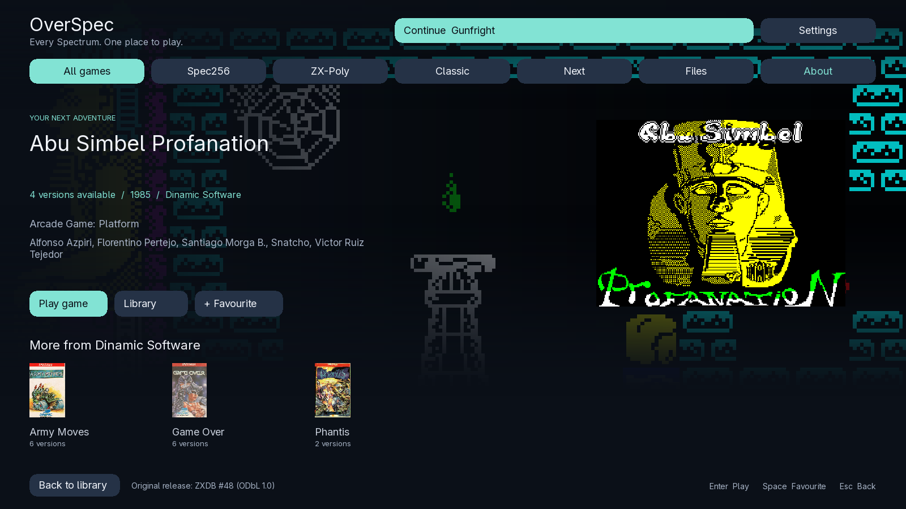
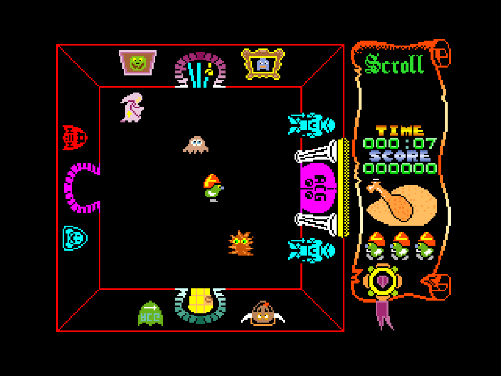

# OverSpec (early test build)

Classic ZX Spectrum games, enhanced colour editions and native Spectrum Next games, together in one library.

> **Expect this to be somewhere between an alpha and a beta.** It has had a lot of polish, but there are probably plenty of problems we have not noticed yet. Things will change before the first full release.

| | |
|---|---|
|  |  |

## Download

Installers for **Windows** and **Linux** are on the [Releases page](https://github.com/jattree/overspec/releases).

| System | File | How to install |
|---|---|---|
| Windows 10 or 11 (64-bit) | `overspec-…-windows-x64-setup.exe` | Run it. It installs for your user only, with a Start menu entry and an uninstaller. |
| Windows, no installer | `overspec-…-windows-x64.zip` | Unzip anywhere and run `bin\overspec.exe`. |
| Linux (x86_64) | `overspec-…-linux-x86_64-portable.tar.gz` | Unpack and run `OverSpec/install.sh`, or run `OverSpec/bin/overspec` directly. Needs glibc 2.35 or newer (Ubuntu 22.04, Debian 12, Fedora 36 and later). |

The **Mac** version will be released soon; it is going through its final testing.

The Windows setup program is not code signed yet, so Windows SmartScreen will warn you. Choose "More info", then "Run anyway".

What changed in each build is in the [changelog](CHANGELOG.md).

## If something goes wrong

Please [open an issue](https://github.com/jattree/overspec/issues) on this repository and say what you were doing, which game, and which system you are on. If it is easier, contact me directly instead. Reports are exactly what this build is for.

## What it is

OverSpec is an emulator built around picking a game and playing it.

- Original cassette covers, loading screens, game information and related games.
- Classic and enhanced editions together. Choose your version when you press Play.
- Spec256, EmuZWin, ZX-Poly and NexClash `.nxc` support, alongside native Spectrum Next games.
- Animated gameplay backdrops, and the ability to record your own previews.
- Cassette-art surrounds, three skins, original pixels, Smooth, Scale2x and Scale4x.
- Controller setup, in-game cheats and options, saves and rewind.
- An updater for `.nxc` patches and their notes.

You supply the games. The `.nxc` updater downloads patches, not copies of the games.

## Getting started

1. Start OverSpec and choose the folder that holds your games, or drop a folder or a game onto the window.
2. Pick a game and press Enter, or A on a controller.
3. In a game, F2 (or the controller's Guide button, or Start and Select together) opens the menu. F1 returns to the library. F11 toggles full screen.

Your saves and settings are kept in your own data folder, never in the program's folder. Settings > Storage shows where, and lets you change it.

## Known limits in this build

- The Windows setup program is unsigned.
- Starting Next games through NextZXOS is not available on Windows; they start directly.
- The Kempston mouse follows the pointer over the game but does not capture it.
- The Linux build is for x86_64 only.

## The `.nxc` patches

The patches and their setup guide are at [jattree/nxc](https://github.com/jattree/nxc).

## Credits

- NexClash / `.nxc`: Dean Woodyatt and Jon Attree. [NexClash](https://github.com/bleughb/nexclash)
- Spec256: Inigo Ayo and David Goti. EmuZWin: Vladimir Kladov. emuspec256 / C-port foundation: Alberto Conde. ZX-Poly: Igor Maznitsa.
- Thanks to the Fuse contributors, ZXDB, Spectrum Computing, RZX Archive and the individual recording authors.

Games, artwork and colour conversions belong to their respective creators and publishers.
