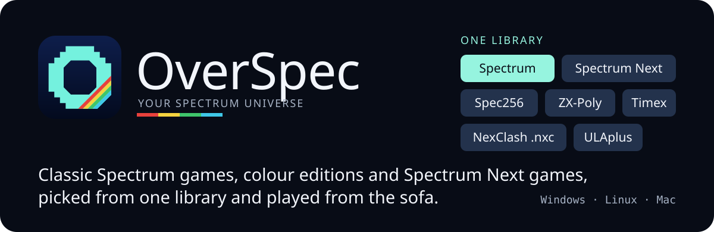

  

  <a href="https://github.com/jattree/overspec/releases/latest"><b>Download</b></a>
  &nbsp;·&nbsp; <a href="USER-GUIDE.md">User guide</a>
  &nbsp;·&nbsp; <a href="CHANGELOG.md">What changed</a>
  &nbsp;·&nbsp; <a href="COMPATIBILITY.md">What has been tested</a>
  &nbsp;·&nbsp; <a href="https://github.com/jattree/overspec/issues">Tell us something</a>

| | |
|---|---|
|  |  |

OverSpec is a ZX Spectrum emulator built around picking a game and playing it. Your games appear with their cassette
covers, loading screens and details, classic and enhanced colour editions of the same game sit together, and the
whole thing works from a game controller as well as the keyboard and mouse. It plays everything from the 16K
Spectrum to the Spectrum Next.

## Download

Get it from the [Releases page](https://github.com/jattree/overspec/releases/latest).

| System | File | How to install |
|---|---|---|
| Windows 10 or 11 (64-bit) | `overspec-…-windows-x64-setup.exe` | Run it. It installs for your user only, with a Start menu entry and an uninstaller. |
| Windows, no installer | `overspec-…-windows-x64.zip` | Unzip anywhere and run `bin\overspec.exe`. |
| Linux (x86_64) | `overspec-…-linux-x86_64-portable.tar.gz` | Unpack and run `OverSpec/install.sh`, or run `OverSpec/bin/overspec` directly. Needs glibc 2.35 or newer (Ubuntu 22.04, Debian 12, Fedora 36 and later). |
| Mac, Apple Silicon (macOS 13 or later) | `overspec-…-macos-arm64.dmg` | Open it and drag OverSpec to Applications. |
| Mac, Intel (macOS 13 or later) | `overspec-…-macos-x86_64.dmg` | Open it and drag OverSpec to Applications. |

**The newest version is 0.7.20261122.** The Spectrum Next runs much closer to the real machine, so effects made part
way down the screen appear where they should and programs that time themselves against the screen behave as they do
on a Next. It gains its Raspberry Pi, WiFi and clock, Timex hi-res pictures show correctly, and the Next runs 7 to 23%
faster. Saved positions for Next games from earlier versions cannot be restored by this one; Spectrum and Spec256
saves are not affected. The [changelog](CHANGELOG.md) has every version.

- **Windows:** the setup program is not code signed yet, so SmartScreen will warn you. Choose "More info", then
  "Run anyway".
- **Mac:** the app is not notarised yet, so macOS will refuse to open it the first time. Right-click OverSpec in
  Applications and choose Open, or allow it under System Settings > Privacy & Security.
- **Already have it?** From 0.6.20261118 on Windows, and 0.6.20261116 on Linux and Mac, OverSpec offers new versions
  by itself. On Windows, 0.6.20261117 and older could not make a secure connection once installed, so they never
  found an update and reports you chose to send were not delivered: please install the newest version by hand.

### Mac users: we need your feedback most

We cannot test the Mac build as widely as the others. It has passed its automated checks on one Apple Silicon Mac,
and the Intel build has only been run under Rosetta, never on a real Intel Mac. So far nobody has heard preview
sound, used a game controller, seen the folder dialog and the Report a problem dialog, updated from an earlier build,
or played online against another computer on a Mac. If you try it, please tell us how it went, even if everything
worked: which Mac, which macOS, whether the window opened, whether games play, whether you hear sound, and which
controller you used. An [issue](https://github.com/jattree/overspec/issues) is the best place.

## What it does

**A library, not a file list.** Original cassette covers, loading screens, game information and related games, with
animated gameplay backdrops and the ability to record your own previews. Classic and enhanced editions of a game are
one entry: choose your version when you press Play.

**Made for the sofa.** A full-screen interface that works entirely from a game controller, with the keyboard and mouse
as alternatives. It has been tested so far with simulated controllers only: tell us how yours behaves.

**Play your way.** Controller setup, in-game cheats and options, saved positions, rewind, and carrying on where you
left off. Cassette-art surrounds, three skins, original pixels, Smooth, Scale2x and Scale4x. Two people can play one
game together online.

**Every machine.** The 16K to +3 Spectrums, the Pentagon, the Timex TC2048 and TS2068, and the Spectrum Next with its
Raspberry Pi (the real NextPi, run by QEMU from your own copy), its WiFi and its clock. The display hardware too:
ULAplus, Timex screen modes, Radastan, Gigascreen, multicolour and SPECTRA.

**Every edition.** Spec256, EmuZWin, ZX-Poly and NexClash `.nxc` editions alongside the originals and native Spectrum
Next games, with an updater for `.nxc` patches and their notes.

The [user guide](USER-GUIDE.md) covers all of it and where to find each part. It also comes with OverSpec as
`USER-GUIDE.html`.

## Getting started

1. Start OverSpec. The games that came with it are already listed. To add your own, open More, then Settings, and
   choose your games folder, or drop a folder or a game onto the window. Choose the folder the games are in, not a
   whole drive.
2. Browse with the arrow keys, the D-pad or the left stick. Enter or A plays; I or Y shows details; Space or X marks
   a favourite; Start or M opens More. Search has an on-screen keyboard.
3. In a game, Escape or F2 (or the controller's Guide button, or Start and Select together) opens the menu. F1
   returns to the library. F11 toggles full screen.
4. The speaker button at the top turns the sound of gameplay previews off and on.

Your saves and settings are kept in your own data folder, never in the program's folder. Settings > Storage shows
where, and lets you change it.

## Games in the box

OverSpec comes with something to play for every kind of display it supports, each in its own folder with a picture:
Timex, multicolour, ULAplus, ZX-Uno and Radastan, Gigascreen, SPECTRA, Spec256 games in 256 colours, and NexClash
`.nxc` patches. A patch is not a game: it needs your own copy of the game it changes.

They are optional. The Windows setup program has a tick box for each folder, and on Linux `install.sh --no-games`
leaves them out. `games/CREDITS.txt` in the package lists every title, whose it is and what is recorded about passing
it on. **If one of them is yours and you would rather it was not here,
[open an issue](https://github.com/jattree/overspec/issues) and it will be removed.**

For everything else, you supply the games. The `.nxc` updater downloads patches, not copies of the games.

<b>Where to find more for each format</b>

| Format | Where to look |
|---|---|
| 16K, 48K and 128K Spectrum games | [Spectrum Computing](https://spectrumcomputing.co.uk/) and [World of Spectrum](https://worldofspectrum.org/) |
| Spectrum Next | [specnext.com](https://www.specnext.com/) and the Spectrum Next games on [itch.io](https://itch.io/) |
| NexClash `.nxc` patches | [jattree/nxc](https://github.com/jattree/nxc), or the updater inside OverSpec |
| Spec256 (256 colours) | the [Spec256 page at Spectrum Computing](https://spectrumcomputing.co.uk/tool/13/Spec256) |
| ZX-Poly | [raydac/zxpoly](https://github.com/raydac/zxpoly) |
| ULAplus | [Spectrum Computing](https://spectrumcomputing.co.uk/) and [ZX-Art](https://zxart.ee/), searching for ULAplus |
| Timex TC2048 and TS2068 | [timexsinclair.com](https://timexsinclair.com/) and [Spectrum Computing](https://spectrumcomputing.co.uk/) |
| Multicolour (BIFROST, NIRVANA) | [Spectrum Computing](https://spectrumcomputing.co.uk/) |
| Gigascreen and other demos | [Demozoo](https://demozoo.org/) and [ZX-Art](https://zxart.ee/) |
| ZX-Uno and Radastan | [ZX-Art](https://zxart.ee/) |
| SPECTRA | the [SPECTRA interface's software page](https://homepages.plus.net/fruitcake/Sinclair/Spectrum/Spectra/SpectraInterface_Software.htm) |
| Gameplay recordings (RZX) | [RZX Archive](https://www.rzxarchive.co.uk/) |

Those sites say which titles their authors and publishers allow to be downloaded. Please respect that.

## What has been tested

[COMPATIBILITY.md](COMPATIBILITY.md) has the result for every file OverSpec has been run against: all 42,427 tapes,
disks and snapshots in the 2012 TOSEC Spectrum set, each compared with a reference emulator, plus the colour editions,
patches and Next games. 95.7% match the reference. A run with nobody at the controls does not show that a game plays
to the end, so the few a person has played are listed separately. If a game you care about is marked as a problem,
tell us in an issue.

### Known limits

- The Windows setup program is unsigned.
- Starting Next games through NextZXOS is not available on Windows; they start directly.
- The Kempston mouse follows the pointer over the game but does not capture it.
- The Linux build is for x86_64 only.
- The Mac build has had far less testing than the others, and is not notarised.
- The controller interface has not yet been tried with a real controller by us; it was tested with simulated ones.
- Gigascreen and other programs on TR-DOS disks need a TR-DOS ROM file of your own.

### Coming next

- Sound for the video previews of enhanced editions; today only previews made from recordings have sound.
- A signed Windows setup program and a notarised Mac app.

If you know of a game or demo that should work and does not, tell us in an issue.

## If something goes wrong

There are three ways to tell us, and all of them help.

- **Report a problem**, in the in-game menu (F2) and in Settings. Pick what kind of problem it is and OverSpec sends
  it. No account is needed.
- If OverSpec crashes or stops responding, the next start asks whether to send a report.
- [Open an issue](https://github.com/jattree/overspec/issues) on this repository and say what you were doing, which
  game, and which system you are on. If it is easier, contact me directly instead.

## Privacy

**Reports.** No report is ever sent unless you choose to send it, and OverSpec lists what a report holds first. A
crash report holds the OverSpec version, your type of system (for example "windows-x64"), the file name of the last
game started and where the program failed. A problem report holds the same, plus your display settings, how many games
are in your library, how long the last scan took and, if you send it from inside a game, the picture the game is
showing. The library screen is never sent. Reports go to a server run by OverSpec's author, and your internet address
is not stored with them.

**Checking for a new version.** OverSpec asks this GitHub page once a day, while it is open, whether there is a newer
version. That request carries the OverSpec version and nothing else about you or your games. When there is a newer
version it asks before downloading or installing anything. Settings > Updates > New version alerts turns the offer
off, and Daily checks stops the checks.

**Playing online.** In a game, open the menu and choose Play online: one player chooses Host a game and reads out the
six-character code it shows, the other chooses Join a game and enters it. You each need the same game file and the
same version of OverSpec. Spectrum Next games work too, when started with Fast start. From a terminal or a front end
the same is `overspec GAME --host` and `overspec GAME --join CODE`. The connection goes through a relay on Cloudflare
run by OverSpec's author, which can see your IP address. It passes each player's controls, and the checks that keep
both games in step, between the two players; it never receives the game file and does not record the game. Nothing
connects to it unless you host or join an online game.

## The `.nxc` patches

The patches and their setup guide are at [jattree/nxc](https://github.com/jattree/nxc).

## Credits

- NexClash / `.nxc`: Dean Woodyatt and Jon Attree. [NexClash](https://github.com/bleughb/nexclash)
- Spec256: Inigo Ayo and David Goti. EmuZWin: Vladimir Kladov. emuspec256 / C-port foundation: Alberto Conde.
  ZX-Poly: Igor Maznitsa.
- Sinclair ROMs are (c) Amstrad, who allow their distribution with emulators. The Timex ROMs are passed on under the
  same statement, as Fuse does.
- Thanks to the Fuse contributors, ZXDB, Spectrum Computing, RZX Archive and the individual recording authors.

Games, artwork and colour conversions belong to their respective creators and publishers.
