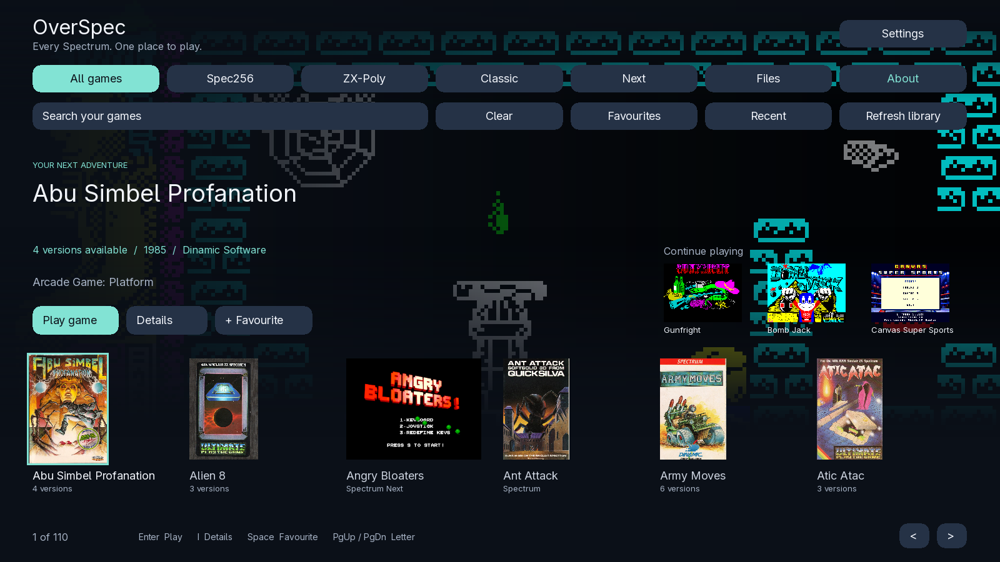

# OverSpec (early test build)

Classic ZX Spectrum games, enhanced colour editions and native Spectrum Next games, together in one library.

> **Expect this to be somewhere between an alpha and a beta.** It has had a lot of polish, but there are probably plenty of problems we have not noticed yet. Things will change before the first full release.

| | |
|---|---|
|  |  |

## Download

Installers for **Windows**, **Linux** and **Mac** are on the [Releases page](https://github.com/jattree/overspec/releases).

| System | File | How to install |
|---|---|---|
| Windows 10 or 11 (64-bit) | `overspec-…-windows-x64-setup.exe` | Run it. It installs for your user only, with a Start menu entry and an uninstaller. |
| Windows, no installer | `overspec-…-windows-x64.zip` | Unzip anywhere and run `bin\overspec.exe`. |
| Linux (x86_64) | `overspec-…-linux-x86_64-portable.tar.gz` | Unpack and run `OverSpec/install.sh`, or run `OverSpec/bin/overspec` directly. Needs glibc 2.35 or newer (Ubuntu 22.04, Debian 12, Fedora 36 and later). |
| Mac, Apple Silicon (macOS 13 or later) | `overspec-…-macos-arm64.dmg` | Open it and drag OverSpec to Applications. |
| Mac, Intel (macOS 13 or later) | `overspec-…-macos-x86_64.dmg` | Open it and drag OverSpec to Applications. |

The newest build, 0.6.20261114, is out for Windows and Linux. Its Mac files will follow; until then the Mac build is 0.6.20261113, on the same Releases page.

### Mac users: we need your feedback most

We cannot test the Mac build as widely as the others. It has passed its automated checks on one Apple Silicon Mac, and the Intel build has only been run under Rosetta, never on a real Intel Mac. If you try it, please tell us how it went, even if everything worked: which Mac, which macOS, whether the window opened, whether games play, and whether you hear sound. An [issue](https://github.com/jattree/overspec/issues) is the best place.

The Mac app is not notarised yet, so macOS will refuse to open it the first time. Right-click OverSpec in Applications and choose Open, or allow it under System Settings > Privacy & Security.

The Windows setup program is not code signed yet, so Windows SmartScreen will warn you. Choose "More info", then "Run anyway".

What changed in each build is in the [changelog](CHANGELOG.md).

## If something goes wrong

There are three ways to tell us, and all of them help.

- **Report a problem**, in the in-game menu (F2) and in Settings. Pick what kind of problem it is and OverSpec sends it. No account is needed.
- If OverSpec crashes or stops responding, the next start asks whether to send a report.
- [Open an issue](https://github.com/jattree/overspec/issues) on this repository and say what you were doing, which game, and which system you are on. If it is easier, contact me directly instead.

Reports are exactly what this build is for.

### What a report holds

Nothing is ever sent unless you choose to send it, and OverSpec shows what will be sent first.

- A crash report holds the OverSpec version, your type of system (for example "windows-x64"), the file name of the last game started and where the program failed.
- A problem report holds the same, plus your display settings, how many games are in your library, how long the last scan took and, if you send it from inside a game, the picture the game is showing. The library screen is never sent.

Reports go to a server run by OverSpec's author, and your internet address is not stored with them.

## What it is

OverSpec is an emulator built around picking a game and playing it.

- Original cassette covers, loading screens, game information and related games.
- Classic and enhanced editions together. Choose your version when you press Play.
- Spec256, EmuZWin, ZX-Poly and NexClash `.nxc` support, alongside native Spectrum Next games.
- Animated gameplay backdrops, and the ability to record your own previews.
- Cassette-art surrounds, three skins, original pixels, Smooth, Scale2x and Scale4x.
- Controller setup, in-game cheats and options, saves and rewind.
- An updater for `.nxc` patches and their notes.

You supply the games. The `.nxc` updater downloads patches, not copies of the games.

## Getting started

1. Start OverSpec and press "Choose games folder" to pick the folder that holds your games with your system's own dialog, or drop a folder or a game onto the window. Choose the folder the games are in, not a whole drive.
2. Pick a game and press Enter, or A on a controller.
3. In a game, F2 (or the controller's Guide button, or Start and Select together) opens the menu. F1 returns to the library. F11 toggles full screen.

Your saves and settings are kept in your own data folder, never in the program's folder. Settings > Storage shows where, and lets you change it.

## What has been tested

[COMPATIBILITY.md](COMPATIBILITY.md) lists every game and demo OverSpec has been run against, 1,656 so far, with the result for each. Most were run automatically and compared with a reference emulator; the few a person has played are listed separately. If a game you care about is marked as a problem, or is not there at all, tell us in an issue.

## Known limits in this build

- The Windows setup program is unsigned.
- Starting Next games through NextZXOS is not available on Windows; they start directly.
- The Kempston mouse follows the pointer over the game but does not capture it.
- The Linux build is for x86_64 only.
- The Mac build has had far less testing than the others, and is not notarised.

## Coming next

OverSpec aims to play every kind of Spectrum game and demo, including the less common display formats. We are working on these now:

- **ULAplus**, the 64-colour palette, for games and recoloured versions that use it.
- **Timex** hi-colour and hi-res screens on the classic machines.
- **Radastan** mode from the ZX-Uno.
- **Gigascreen**, where two screens are blended into one.
- **SPECTRA** interface display modes.

If you know of a game or demo that uses one of these and should work, tell us in an issue.

## The `.nxc` patches

The patches and their setup guide are at [jattree/nxc](https://github.com/jattree/nxc).

## Credits

- NexClash / `.nxc`: Dean Woodyatt and Jon Attree. [NexClash](https://github.com/bleughb/nexclash)
- Spec256: Inigo Ayo and David Goti. EmuZWin: Vladimir Kladov. emuspec256 / C-port foundation: Alberto Conde. ZX-Poly: Igor Maznitsa.
- Thanks to the Fuse contributors, ZXDB, Spectrum Computing, RZX Archive and the individual recording authors.

Games, artwork and colour conversions belong to their respective creators and publishers.
